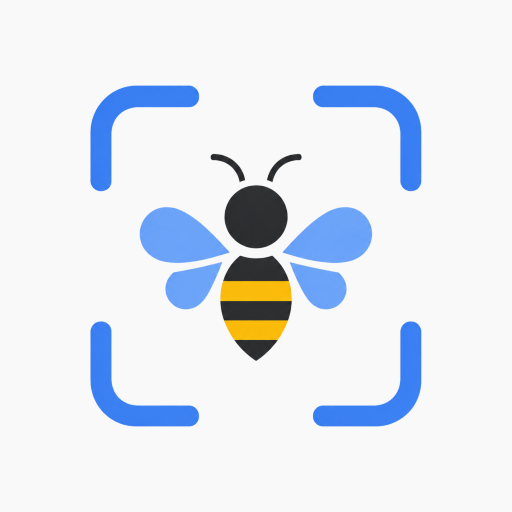

<p align="center">
  
</p>

<h1 align="center">FaunaPulse</h1>

<p align="center">
  <strong>Transform your Android smartphone into an AI-powered wildlife camera</strong>
</p>

<p align="center">
  Detect, track and identify fauna using on-device artificial intelligence, motion-trigger, time-lapse image capture (including night mode) or scheduled video recordings.
</p>

<p align="center">
  On-device AI · Real-time detection & tracking · Custom AI models · Works offline
</p>

<p align="center">
  <a href="https://play.google.com/store/apps/details?id=com.faunapulse.app"></a>
  <a href="https://doi.org/10.5281/zenodo.22309221"></a>
  <a href="https://github.com/valentinitnelav/fauna-pulse/releases"></a>
  <a href="LICENSE"></a>
  <a href="https://huggingface.co/collections/Valen-Peregrine/faunapulse-6ad22f04766aed6641688544"></a>
</p>

<p align="center">
<a href="https://play.google.com/store/apps/details?id=com.faunapulse.app"></a>
</p>

<p align="center">
  
  &nbsp;&nbsp;
  
  &nbsp;&nbsp;
  
  &nbsp;&nbsp;  
  
  &nbsp;&nbsp;
  
</p>

## Overview

**FaunaPulse** is a free (and ad-free), open-source smartphone app for wildlife monitoring that **allows you to integrate your custom AI-based object detection and classification models directly on your smartphone** (no AI in the cloud, your data stays yours).

Think of **FaunaPulse** as the chassis of a car where you can drop in your own engine: the app is the platform, the AI models are the engine, and together they *detect*, *track* and *identify* your favorite fauna (from pollinators and birds to mammals).

> [!IMPORTANT]
> **Detection, tracking, and classification quality will vary based on the [custom AI models used][hf_fp_models]. With our [documentation and Python tools][fp_models], you can also export models tailored to your specific imagery and use case.**

The primary scientific use case of FaunaPulse is estimating **visitation rates** in ecological studies (who visits whom and how many times). For example, how often pollinators visit a flower or inflorescence per unit of time and how long each visit lasts. This is a proxy for pollination which can be vital for the reproduction of many plants, including for crop yield and quality.

For older or used Android smartphones not capable of supporting AI models, its sister app, [**FaunaLapse**][fauna_lapse], is a light application that can turn such phones into time-lapse cameras. However, FaunaPulse can also work in non-AI mode, capturing time-lapse images and videos.

FaunaPulse is open source under the **AGPL-3.0 license**, which it inherits from the [Ultralytics YOLO Flutter plugin](https://github.com/ultralytics/yolo-flutter-app) it is built on (details in [License](#license-agpl-30)).

### Further details

<details>
	<summary>Expand:</summary>

Detection, tracking, classification and any image processing run **fully on-device** using [LiteRT](https://github.com/google-ai-edge/litert), so **an internet connection is not required in the field** and your data stays under your control. The phone needs the internet only once, to download the AI detectors and classifiers (or you can place them on the phone yourself, from your computer).

A draggable square **region of interest (ROI)** can be placed over a flower (or feeding site, nest entrance, animal path, observation area of interest, etc.). FaunaPulse then records activity within that region and also saves (locally, on device) ROI-cropped JPEG images (or videos) together with metadata. At the end of the recording session, it opens the **Session summary** screen with numbers and graphs about the visitation rates and the captured images with the tracked objects for preview and check (the **Dashboard** on the home screen sums up all sessions). Saved images, videos and session metadata can later be exported on a PC for further (re)analysis or directly in research workflows.

The **Identify organisms** step runs an image classifier such as [BioCLIP 2 or 2.5][bioclip] (or the insectDCT classifier) on the phone itself, over the saved crops of every track ID. The model and a name list are downloaded in the app on the **Download & import models** screen, or imported (see [IDENTIFICATION.md](docs/IDENTIFICATION.md)). BioCLIP and similar classification tools can of course still be used on a computer, after the detection results are transferred from the smartphone. For that, you can check [insect-detect-post](https://github.com/maxsitt/insect-detect-post), the classification software developed by my colleague, Maximilian Sittinger, designed to run on a PC (with or without a GPU). The PC tool [fauna-pulse-export][fp_export] adapts FaunaPulse sessions to the data structure that software package ingests, and puts the names from both programs side by side per track ID.

Saved images can also be reviewed and cropped by hand. The crops can then be shared with identification apps such as [Seek by iNaturalist](https://www.inaturalist.org/pages/seek_app), [ObsIdentify](https://observation.org/apps/obsidentify/), [BeeMachine](https://www.beemachine.ai/) or another service you prefer. Note that, at the time of releasing this repository, these apps take one image per upload and need an internet connection, while FaunaPulse is designed for offline use and identification in bulk on the device (e.g. with BioCLIP models), which scales monitoring while keeping your data local.

</details>

## Demos & Tutorials

### Demos (YouTube)

#### Live-AI detection & tracking

Demonstrates real-time AI tracking of organisms.

<p align="center">
  <a href="https://www.youtube.com/watch?v=S-FVpT6K3-I"></a> 
</p>

#### Detection & tracking in post-processing

Demonstrates AI tracking of organisms on previously recorded videos (either within the app, or imported from your camera app or other sources).

<p align="center">
  <a href="https://www.youtube.com/watch?v=rCNEcfg4Rfc"></a>  
</p>

---

### Tutorials (YouTube)

<p align="center">
  <a href="https://www.youtube.com/watch?v=Ql_NyHM_RQA"></a>
  &nbsp;&nbsp;
  <a href="https://www.youtube.com/watch?v=ScNR98OW6T0"></a>
</p>

Example of two short videos (about 70 s each) which show how to find and name the animals in a saved video, on the phone:
[insects](https://www.youtube.com/watch?v=Ql_NyHM_RQA) and
[mammals](https://www.youtube.com/watch?v=ScNR98OW6T0). Try it yourself with the same two demo
videos and the [written tutorial](docs/TUTORIAL_VIDEO_ANALYSIS.md).

More demo & tutorial videos are in the [FaunaPulse YouTube playlist](https://www.youtube.com/playlist?list=PLAgrK7hpiwrI).

## News & posts

<!-- Gallery: newest post first, left to right, 3 cells per row. A new post goes into the first
cell and the others move one cell to the right. The number of cells sets the thumbnail size: the
cells always share the full page width, so width="33%" must equal 100% divided by the number of
cells (it only keeps the columns equal). Keep the empty cells (<td width="33%"></td>): without
them the first picture grows to the full page width. Keep captions to about 6 to 8 words: they
wrap in narrow columns. Keep about 2 rows here and move older posts to docs/NEWS.md. Leave out
like counts (they go out of date) and results that are not published yet (every release archives
this file on Zenodo). -->

<table>
  <tr>
    <td width="33%" valign="top">
      <a href="https://www.linkedin.com/feed/update/urn:li:activity:7524514211994083329/"></a><br>
      <strong>2026-11-06:</strong> <a href="https://www.linkedin.com/feed/update/urn:li:activity:7524514211994083329/">Naming tracked organisms from all their photos</a>
    </td>
    <td width="33%"></td>
    <td width="33%"></td>
  </tr>
</table>

## Modes of operation

FaunaPulse supports several **modes of operation**:

1. **Real-time detection and tracking** using AI detectors of your choice;
2. **Motion-triggered** image capture;
3. **Scheduled time-lapse** image capture (including **nocturnal mode** using the phone's torch / flashlight);
4. **Scheduled video recordings** (AI detection can run on them later, see mode 5);
5. **Post-capture AI detection & tracking on videos**, locally on the smartphone, on videos recorded with FaunaPulse or imported from other sources;
6. **Post-capture AI detection on images** captured with the motion or time-lapse mode, using either a single-detector pass or the moving window / tiling approach - [SAHI (Slicing Aided Hyper Inference)][sahi]. SAHI runs slow (depending on your smartphone model) but it can help reduce the amount of "empty" images (without pollinators / target organisms) that are usually captured via the motion-triggered or time-lapse modes.
Though not advised, track IDs can be found on these photos too (**Find track IDs** on the **Find animals in photos** screen), but only when the photos were taken at most 0.5 s apart, because a tracker needs a high frame rate. For photos further apart, use mode 1 (live AI) or 4 (video) if tracking is needed.
7. **Post-capture AI classification**, for example using an adapted [BioCLIP 2][bioclip2] image classifier running directly on your smartphone (very old smartphones will be limited or not have the needed compute power). Classification is focused on the detected organisms (an organism is cropped with the bounding boxes predicted by the detector) and not the entire frame.

Modes 1-4 can also be **scheduled** (**Scheduled recording**: up to three daily windows, for example 1st run 9:00-12:00, 2nd run 13:00-17:00, repeated for 1 to 14 days), for example when the smartphone(s) are deployed over multiple days or for recording in time-lapse mode for nocturnal activity. A window cannot cross midnight: for a night, use two windows (one before and one after midnight).

## Broad examples of usage

<details>
	<summary>Expand:</summary>

- **Pollination questions / research:** measure and compare flower-visitation rates among plant species, floral patches, (e.g., across habitats, habitat restoration, patch structure, land-management practices and intensity, agriculture, environmental conditions / gradients, research treatments, etc.).
- **Citizen science:** collect observations on flower visitors, wildlife and other fauna using an ordinary smartphone.
- **Wildlife activity:** record when, how often and for how long fauna/organisms appear within a selected observation area.
- **Biodiversity documentation:** capture fauna occurrences or events using AI detection, motion triggering or time-lapse capture across various habitats.
- **Wildlife surveys with custom AI models:** monitor wildlife categories supported by compatible object-detection and classification models. Train your custom models and deploy them on the FaunaPulse app.

</details>

## Project status & General limitations

<details>
	<summary>Expand:</summary>

FaunaPulse is a **research preview (beta)**, provided as a free, experimental field tool. Validation is ongoing. Please treat it accordingly. Below are some important remarks:

- Only Android is currently supported. iOS support is postponed to a later phase (if there is significant demand, as this expansion is costly on my time and resources at the moment).
- FaunaPulse is made for smartphones mounted upright (portrait) on a tripod, clamp or stake. Tablets are not supported. A phone mounted sideways still works, but the app does not notice the turn. Details in the [Field Guide](docs/FIELD_GUIDE.md) (*Physical setup*).
- AI-based monitoring requires compatible quantized `.tflite` models. FaunaPulse was designed so that end-users can add their own models (one for detection and another one for classification). Each publicly available model comes with its own narrow scope and limitations, which FaunaPulse cannot fix. See further details in [MODEL_CONVERSION.md](docs/MODEL_CONVERSION.md) and in each model card on [Hugging Face][hf_fp_models].
- Built-in (on-device) taxonomic identification in bulk needs a BioCLIP model file (large files: about 0.6 to 1.3 GB) and a name list (called a "label pack" on Hugging Face; ready-made ones can be downloaded in the app, custom ones can be prepared on a PC). BioCLIP identification cannot run in real time, and its results vary significantly with image quality.
- Each scientific application should be validated under its intended field conditions and tailored AI models before data collection at scale.
- Visit counts may include missed, duplicated, split (fragmented) or merged tracks. Therefore, review outputs and consider those limitations before drawing strong scientific conclusions. From my observations, abundance will most probably be overestimated. Correcting that bias is work in progress.
- The quality of results depends on many factors, including the AI model, its generalisability, smartphone specs and handling, image quality, morphological complexity of the monitored organisms and their occurrence backgrounds, field setup, weather conditions, time of the day or of the year, etc.
- Smartphones are not usually designed to endure scorching sun or rain, so please use waterproof and/or thermal casing, USB (magnetic) coolers or simple shading if you plan to operate in such conditions. There are options on online markets and I prefer to avoid advertising any in particular. Your advice and creative solutions are very welcome, as long as they are safe to use.
- **Device temperature** can vary substantially between phone models and with ambient temperature. Prolonged continuous on-device inference can cause some devices to become warm, trigger thermal throttling, or drain the battery more quickly (especially over 40°C). Some FaunaPulse operation modes include thermal-management measures, but thermal behavior depends on the phone hardware, operating system, operation conditions and handling and cannot be guaranteed for every smartphone. Some phone models can also overheat faster while charging. **If your device becomes excessively hot (e.g. over 40-45°C) or displays a thermal warning (even when using cooling options / thermal casing), stop using it and allow the device to cool before continuing, or use another phone model with safer thermal throttling features.**

</details>

## Getting started - Install the app

<details>
	<summary>Expand:</summary>

NOTE:

> FaunaPulse is in beta: it works, but it is still being tested and improved, so please report problems as [GitHub issues](https://github.com/valentinitnelav/fauna-pulse/issues).

**Install the app.** The easiest way is Google Play, which also notifies you when there are new versions available:

<a href="https://play.google.com/store/apps/details?id=com.faunapulse.app"></a>

Other options (see [Installation & Testing Guide](docs/INSTALL.md)):

1. **Download the latest APK file from the [GitHub Releases](https://github.com/valentinitnelav/fauna-pulse/releases) page**; WikiHow provides a tutorial with the necessary steps: [How to Download & Install an APK on Android: Full APK Guide](https://www.wikihow.com/Install-APK-Files-on-Android). See also "Track A" in [Installation & Testing Guide](docs/INSTALL.md) for a guide example with screenshots. However, this option does not come with auto-updates - see next option with Obtainium for that.
2. **Install & auto-update via [Obtainium](https://wiki.obtainium.imranr.dev/)**. Obtainium is an app that allows you to install and update FaunaPulse  directly from this GitHub repository. It also provides notifications for new releases. See "Track A2b" in [Installation & Testing Guide](docs/INSTALL.md)  
3. **Build directly from source with the latest features and bug fixes**. For advanced users comfortable with a terminal. Only Linux support for now (free and open-source), but your favorite LLM / chat-bot can help you for proprietary operating systems (macOS, Windows). Basically, you will build the app based on what is right now on GitHub, branch `main` provides a stable version of the app, tested on a smartphone. The branch `develop` is more active, but occasionally less stable. See "Track B" in [Installation & Testing Guide](docs/INSTALL.md).

</details>

## Documentation

<details>
	<summary>Expand:</summary>

Documentation is work in progress and very time-consuming so LLMs were often used for language edits. Coding agents will also be pointed to these documentation files to get an "understanding" of the repository.

| Document | Main audience | Purpose |
|---|---|---|
| [README.md](./README.md) | Everyone | This document |
| [INSTALL.md](docs/INSTALL.md) | Tester / developer | Install a ready-made APK or build from source; import models. |
| [TUTORIAL_VIDEO_ANALYSIS.md](docs/TUTORIAL_VIDEO_ANALYSIS.md) | New user | Try FaunaPulse in a few minutes: find, track and name the animals in two demo videos. |
| [CHANGELOG.md](./CHANGELOG.md) | Everyone | What changed between releases. |
| [PRIVACY_POLICY.md](./PRIVACY_POLICY.md) | Everyone | What the app does (and does not) collect, permission by permission. |
| [FIELD_GUIDE.md](docs/FIELD_GUIDE.md) | Field researcher | Run a session, read the live screen and troubleshoot. |
| [DATA_GUIDE.md](docs/DATA_GUIDE.md) | Researcher / analyst | Read the `session.jsonl` data dictionary and compute visitation rates in R or Python. |
| [VIDEO_ANALYSIS.md](docs/VIDEO_ANALYSIS.md) | Researcher / analyst | Count track IDs in imported videos, check them against a hand count (BORIS or spreadsheet) and find the frame rate that is enough. The checking method is work in progress. |
| [SETTINGS_REFERENCE.md](docs/SETTINGS_REFERENCE.md) | Field researcher | Understand every user setting. |
| [HOW_PHOTO_RESOLUTION_WORKS.md](docs/HOW_PHOTO_RESOLUTION_WORKS.md) | Developer | Understand why a small ROI can still yield sharp photographs. |
| [ARCHITECTURE.md](docs/ARCHITECTURE.md) | Developer | Understand the data flow and native-to-Dart contract. |
| [CONTRIBUTING.md](docs/CONTRIBUTING.md) | Developer | Build, test and follow repository conventions. |
| [MODEL_CONVERSION.md](docs/MODEL_CONVERSION.md) | Developer | Which model formats the app runs; the conversion tools are in [fauna-pulse-models][fp_models]. |
| [Model cards on Hugging Face][hf_fp_models] | Developer / tester | Where each model the app offers comes from, how it was converted for the phone, its licence and how to cite it. The conversion tools and the cards' sources are in [fauna-pulse-models][fp_models]. |
| [IDENTIFICATION.md](docs/IDENTIFICATION.md) | Researcher / developer | Identify the recorded animals on the phone ([BioCLIP 2 or 2.5][bioclip], insectDCT classifier): how to run it, read the results, and how the method works. |
| [PERFORMANCE_BENCHMARKING.md](docs/PERFORMANCE_BENCHMARKING.md) | Developer | How to measure performance (paired-run protocol). |
| [LEAN_QNN_PACKAGING.md](docs/LEAN_QNN_PACKAGING.md) | Maintainer | The lean (no-QNN) default build and the optional Snapdragon NPU edition (`-P qnn=true`). |
| [FAUNAPULSE_FORK.md](./packages/ultralytics_yolo/FAUNAPULSE_FORK.md) | Developer / reviewer | What FaunaPulse changed in its copy of the Ultralytics plugin vs upstream; re-audit checklist. |
| [AGENTS.md](./AGENTS.md) | Code agent | A coding agent will first read this file to build context. |
| [AGENT_CHANGELOG_OVERVIEW.md](docs/AGENT_CHANGELOG_OVERVIEW.md) | Code agent | Current-state development overview. |
| [AGENT_CHANGELOG.md](docs/AGENT_CHANGELOG.md) | Code agent | Detailed append-only development journal. |

</details>

## AI Models

AI **detectors** and **classifiers** (quantised `tflite` files) are not shipped with the app (e.g., via Google Play) or stored in this GitHub repository. The app downloads them on the phone. The models are published on [Hugging Face][hf_fp_models], one repository per model family, each with a model card (where the model comes from, how it was converted, how to cite it) and the original model's licence.

The tools to convert and quantise the models published on Hugging Face (or any other compatible model you may have) are provided on the GitHub repository [fauna-pulse-models][fp_models].

<details>
	<summary>Expand:</summary>

### Detectors

The **Download & import models** screen (home screen: *AI models* in the bottom bar, or the Menu) offers several quantised detectors.
Their original GitHub repositories are listed below:

- [flat-bug][flatbug] (sizes `n` and `s`) mostly trained on dead specimens, so try it when aiming the camera at a homogenous background; for insects the app suggests it as a demo detector,
- [insectDCT][insectdct] (size `s`) try it for insects on flowers,
- [MegaDetector v6][mgdetv6] for common animals (3 classes: *animal, person, vehicle*).

Classifiers (identification models) are offered the same way.

A custom pollinator detector is planned for training and release based on collected smartphone images. A sample of this dataset is published on Zenodo - *Dataset of arthropod flower visits captured via smartphone time-lapse photography*, [Ştefan et al. 2025][zenodo_phones].

Custom AI detectors can be added on the same screen:

- **Download from a link…**, pasting a link to a model file or name list (`.tflite`, `.fpack`), or
- **Import model files…**, selecting one or more model files (`.tflite`) or name lists (`.fpack`) stored on the phone (the app checks that each is a detection model, an identification model or a name list and puts it in its place), or
- train and export your own, see [MODEL_CONVERSION.md](docs/MODEL_CONVERSION.md) and the export tools of [fauna-pulse-models][fp_models]. For training tutorials you can check the examples provided by my colleague, Maximilian Sittinger, [Insect Detect ML][maxs_train].

Add only model files and links from people or websites you trust: the app checks what a file is (a model or a name list), not who made it.

See also the [Installation & Testing Guide](docs/INSTALL.md) for how models reach the phone.

**Motion-triggered** and **time-lapse** capture do not need any detection model.

### Classifiers (identification models)

- [BioCLIP 2][bioclip2]
- [BioCLIP 2.5][bioclip25] (newer and larger but slower and requires more RAM on your phone)
- [insectDCT][insectdct]

Classifiers run in bulk on the phone, without an internet connection. Start them with **Identify organisms** on the **Session summary** screen, or in a session's ⋮ menu on the **Sessions** screen (see [IDENTIFICATION.md](docs/IDENTIFICATION.md)).

BioCLIP chooses each animal's name from a name list. Such lists are prepared per region (e.g. Europe) and taxonomic categories (e.g. common orders of pollinators) for the animals you watch. Narrowing the scope of the large name lists can help with more realistic identification results. For example, there is no need to allow a model to think that zebras can be found within the wildlife of Europe or act as pollinators. At least not in this universe...

### AI Models' licenses

These models were made by other research teams. FaunaPulse tools adapted them to run on a phone, and each model keeps its creators' licence.

Each model card on [Hugging Face][hf_fp_models] names the original authors, the licence and how to cite the model. In the app, the ⓘ card of each model and name list downloaded from there links its model card. If you publish results, please also cite the original model as its authors ask.

</details>

## Contributing & Maintenance

<details>
	<summary>Expand:</summary>

FaunaPulse is developed as an open research project.

Contributions are welcome. Fork the repo, start a short-lived branch from `develop` and open
the pull request back into `develop`. `main` is kept stable for reviewed
changes. The [contributor guide](docs/CONTRIBUTING.md) explains setup, testing,
branch names and the dependency-update workflow.

If you want to contribute to this project, here are some main ideas where help is appreciated:

- [ ] discussions about optimal workflows for **aggregation of classification outputs per track ID**. See already a discussion started here [#25]
- [ ] **iOS** development. The Ultralytics plugin supports iOS, but adapting FaunaPulse will require a significant amount of resources for me, so I have parked this idea for now.

[#25]: https://github.com/valentinitnelav/fauna-pulse/issues/25

</details>

## Why I built FaunaPulse

<details>
	<summary>Expand:</summary>

The idea for FaunaPulse grew from my past research at the Helmholtz Centre for Environmental Research [(UFZ)][ufz] and the German Centre for Integrative Biodiversity Research [(iDiv)][idiv] (see below at *Past Research*).

During my [PhD][phd_stef] research, my field-team and I used affordable smartphones in time-lapse mode to record flower-visiting insects.
While this was ok, it quickly highlighted some core challenges that motivated the creation of FaunaPulse:

- **Eliminating data overload at the source**: Pollinator visits are brief and infrequent, meaning time-lapse capture generated millions of empty images that overloaded storage and processing time. Post-processing tools like [MegaDetector][mgdet] filter out empty trail camera photos of popular wildlife after collection, and FaunaPulse places that kind of AI processing directly on the phone. So, running detection on-device ensures one captures and stores images when fauna are actually present.
- **Overcoming traditional sensor limitations**: Standard motion sensors trigger continuously on wind, moving vegetation, or changing sunlight. Heat-based sensors ([Passive infrared sensors][PIR]) are impractical on small insects whose body temperature matches their surroundings. So, on-device computer vision seems like the only reliable way to trigger recordings for flower visiting insects.
- **Focusing AI on ecological context (Region of Interest - ROI)**: As first suggested in [Ștefan et al. 2025][stefan-2025-a], focusing the camera on a target area (for example, a single flower) reduces background clutter and matches the square input format standard in object-detection models.
- **Democratizing wildlife monitoring through accessible and affordable hardware**: Commercial camera traps, microcomputers or other gadgets are not available on all markets at all times, some are expensive and some can also be complex to work with. Modern smartphones are powerful, globally accessible microcomputers and almost everyone understands nowadays how to use one. By releasing FaunaPulse as free and open-source software, I want to enable citizen scientists, students, and under-funded research groups to turn everyday phones into tailored camera traps for documenting local biodiversity. Also, I am not sure if expensive (luxury) smartphones end up as research tools deployed in field conditions, therefore the focus on Android affordable smartphones...growing up in poverty, my main motivation is to empower those with less money.

### Past Research

FaunaPulse builds on research conducted with colleagues at [UFZ][ufz] and [iDiv][idiv] on smartphone-based pollinator monitoring, object detection and insect classification:

- Stark, T., Ștefan, V., Wurm, M., Spanier, R., Taubenböck, H., & Knight, T. M. (2023). **YOLO object detection models can locate and classify broad groups of flower-visiting arthropods in images.** *Scientific Reports*, 13, 16364. [https://doi.org/10.1038/s41598-023-43482-3][stark-2023]
- Ștefan, V., Workman, A., Cobain, J. C., Rakosy, D., & Knight, T. M. (2025). **Utilising affordable smartphones and open-source time-lapse photography for pollinator image collection and annotation.** *Journal of Pollination Ecology*, 38, 1–21. [https://doi.org/10.26786/1920-7603(2025)778][stefan-2025-a]
- Ștefan, V., Stark, T., Wurm, M., Taubenböck, H., & Knight, T. M. (2025). **Successes and limitations of pretrained YOLO detectors applied to unseen time-lapse images for automated pollinator monitoring.** *Scientific Reports*, 15, 30671. [https://doi.org/10.1038/s41598-025-16140-z][stefan-2025-b]
- Stark, T., Wurm, M., Ștefan, V., Wolf, F., Taubenböck, H., & Knight, T. M. (2025). **Utilizing CNNs for classification and uncertainty quantification for 15 families of European fly pollinators.** *PLOS ONE*, 20(9), e0323984. [https://doi.org/10.1371/journal.pone.0323984][stark-2025]

[stark-2023]: https://doi.org/10.1038/s41598-023-43482-3
[stefan-2025-a]: https://doi.org/10.26786/1920-7603(2025)778
[stefan-2025-b]: https://doi.org/10.1038/s41598-025-16140-z
[stark-2025]: https://doi.org/10.1371/journal.pone.0323984

</details>

## AI-assisted development and transparency

<details>
	<summary>Expand:</summary>

FaunaPulse also began as a personal experiment in what is called “vibe coding”. Developing a custom smartphone field tool initially seemed likely to require substantial funding and professional app developers. As AI-assisted software-development tools became more capable, I decided to explore whether they could help me build the application myself.

I am a curious scientist with experience in R, Python, statistics and computer vision, but I am not a professional mobile-app developer. Software development was assisted by [Claude Code](https://claude.com/product/claude-code), a paid tool that was instrumental in making this project possible. I recognize that access to paid AI tools is not equally available.

I defined the scientific requirements and design decisions, tested the application repeatedly on smartphones, inspected its outputs, reviewed and created documentation and code, and overall architected the resulting software. Occasionally, ChatGPT or Gemini (via web chat) and [Codex](https://openai.com/codex/) were used as additional sources of "critique".

Scientific literature was located using [Google Scholar](https://scholar.google.com), [Elicit](https://elicit.com/) and [Consensus](https://consensus.app/).

For transparency, the development process is automatically documented in [`AGENT_CHANGELOG_OVERVIEW.md`](docs/AGENT_CHANGELOG_OVERVIEW.md) and the very detailed [`AGENT_CHANGELOG.md`](docs/AGENT_CHANGELOG.md). Also, the Git history provides the corresponding code-level record.

</details>

## Privacy

<details>
	<summary>Expand:</summary>

FaunaPulse is designed as a free, transparent and open research tool for monitoring biodiversity.
The app does not collect nor transmit private user data: no account, no analytics, no user tracking.

AI models run directly on the phone and everything recorded stays in the app's folder on the device.

**Staying safe:**

- Install FaunaPulse only from Google Play, from the [GitHub Releases](https://github.com/valentinitnelav/fauna-pulse/releases) page of this repository, or with Obtainium from that page. Do not install copies from other places.
- Import model files, name lists and FaunaLapse zips only from people or websites you trust. Models from the app's own list come from a fixed version on Hugging Face and are checked with a checksum (a fingerprint of the file) before use.
- Saved and shared crops include the session position (GPS). For sites that must stay private, such as sites of rare species, turn off "Add the position to exported crops" in Session settings (Photos tab).
- Problem reports leave out the position and the field notes you typed. Still, read a report before you post it in a public place.
- Use a screen lock on field phones and install Android's security updates. On Android 10 and older, other apps with the storage permission can read the session folder.
- To report a security problem privately, see [`SECURITY.md`](SECURITY.md).

See [`PRIVACY_POLICY.md`](PRIVACY_POLICY.md) (in the app: **Menu** → **Privacy policy**) for the permission-by-permission detail,
and [`CHANGELOG.md`](CHANGELOG.md) for what changed between releases.

</details>

## License (AGPL-3.0)

FaunaPulse, including this code repository is licensed under **AGPL-3.0** inherited from the modified `ultralytics_yolo` plugin (in `./packages`).

See [`LICENSE`](LICENSE) for details.

The frame for deploying an AI model in FaunaPulse is built on Ultralytics' open-source [`yolo-flutter-app`](https://github.com/ultralytics/yolo-flutter-app), from upstream commit `22b2e5d`.
The modified Ultralytics plugin is retained in [`packages/ultralytics_yolo/`](packages/ultralytics_yolo/) and remains subject to its own LICENSE.

## Citation

If you use FaunaPulse in your research, please cite it using the metadata in [`CITATION.cff`](CITATION.cff). 
GitHub renders a ready-made "Cite this repository" button from that file (top-right of the repository page).

Example:

> Ștefan, V., Sittinger, M., & Knight, T. (2026). FaunaPulse: a smartphone application for on-device detection, tracking and identification of animals [Software]. Zenodo. https://doi.org/10.5281/zenodo.22309221. Source code: https://github.com/valentinitnelav/fauna-pulse

Every release is archived on Zenodo. The concept DOI [10.5281/zenodo.22309221](https://doi.org/10.5281/zenodo.22309221) always resolves to the newest version; each release also carries its own version DOI, listed on its Zenodo page and in `CITATION.cff`. 

In the app, **Menu** → **Cite FaunaPulse** on the home screen shows the citation of the version installed on the phone and the DOI link.

## Notes on repository layout

<details>
<summary>Show repository structure</summary>

```text
fauna-pulse/
├── android/                 # Android platform code
├── assets/models            # Optional local models
├── docs/                    # Documentation: installation, field-use, etc.
├── lib/                     # FaunaPulse application code (Dart)
├── ...
├── packages/
|   └── ultralytics_yolo/    # Modified Ultralytics YOLO Flutter plugin
├── ...
└── tool/
    ├── model_downloads      # The app's download list and the naming rule of model files
    └── video_eval           # Scoring track IDs against hand counts
```

The PC tools that convert models for the phone (detectors, classifiers, BioCLIP) live in a
separate repository, [fauna-pulse-models][fp_models].

The application now sits at the repository root. The older path `/yolo-flutter-app/example/` may still appear in the historical development logs.

The application uses the local modified plugin through `pubspec.yaml`:

```yaml
dependencies:
  ultralytics_yolo:
    path: packages/ultralytics_yolo
```

</details>

<!-- 
Reference links: [id]: URL
These are links used throughout this file
-->

[ufz]: https://www.ufz.de/
[idiv]: https://www.idiv.de/
[bioclip]: https://imageomics.github.io/bioclip-ecosystem/index.html
[bioclip2]: https://imageomics.github.io/bioclip-2/
[bioclip25]: https://huggingface.co/imageomics/bioclip-2.5-vith14
[sahi]: https://github.com/obss/sahi
[flatbug]: https://github.com/darsa-group/flat-bug
[insectdct]: https://github.com/kimbjerge/insectDCT
[mgdet]: https://github.com/microsoft/MegaDetector
[mgdetv6]: https://github.com/microsoft/MegaDetector/releases/tag/megadetector-v6.0
[phd_stef]: https://repo.bibliothek.uni-halle.de/handle/1981185920/125596
[PIR]: https://en.wikipedia.org/wiki/Passive_infrared_sensor
[zenodo_phones]: https://doi.org/10.5281/zenodo.15096610
[maxs_train]: https://github.com/maxsitt/insect-detect-ml
[hf_fp_models]: https://huggingface.co/collections/Valen-Peregrine/faunapulse
[fp_models]: https://github.com/valentinitnelav/fauna-pulse-models
[fp_export]: https://github.com/valentinitnelav/fauna-pulse-export
[fauna_lapse]: https://github.com/valentinitnelav/fauna-lapse